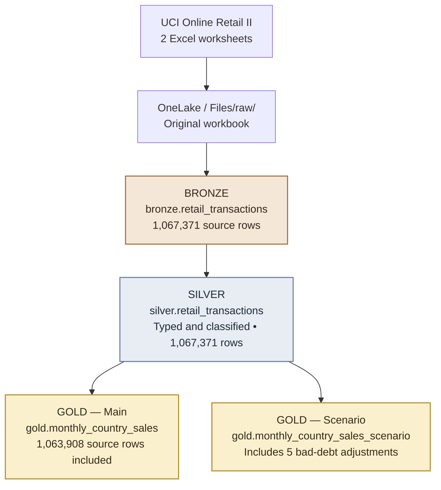

# Microsoft Fabric Medallion Architecture — Retail Transactions

**Bronze → Silver → Gold | Microsoft Fabric · PySpark · Delta Lake**

This project follows **1,067,371 retail transaction rows** through a Microsoft Fabric Lakehouse to answer a practical question:

> **How can five records change a financial metric by £158,676.14 without any change to the source data?**

The experiment preserves raw records, classifies transactions in Silver, and compares two explicit business rules in Gold. It uses the [UCI Online Retail II dataset](https://archive.ics.uci.edu/dataset/502/online+retail+ii). **All monetary values are GBP (£), not USD.**

## Results at a glance

| Measure | Verified result |
| :--- | ---: |
| Source rows ingested | **1,067,371** |
| Rows retained in Silver | **1,067,371** |
| Source rows included in the main Gold calculation | **1,063,908** |
| Main Gold net sales | **£19,445,553.14** |
| Alternative Gold net amount | **£19,286,877.00** |
| Impact of including five bad-debt adjustments | **−£158,676.14** |

**Key point:** The difference is caused by **business-rule selection**, not extra revenue or lost records.

---

## 1. Architecture

All three layers are **schemas within one schema-enabled Lakehouse**, `RetailMedallion`. The Gold tables are stored in Delta format and queried with Spark SQL. The diagram renders as a flowchart on GitHub.

### Project notebooks

| Notebook | What it does |
| :--- | :--- |
| [`NB_01_Bronze_Ingestion.ipynb`](NB_01_Bronze_Ingestion.ipynb) | Reads both Excel worksheets, preserves source values and records file/worksheet origin. |
| [`NB_02_Silver_Transformation.ipynb`](NB_02_Silver_Transformation.ipynb) | Converts types, assigns `TransactionClass`, adds quality flags and calculates `LineAmount`. |
| [`NB_03_Gold_Aggregation.ipynb`](NB_03_Gold_Aggregation.ipynb) | Builds monthly/country metrics, reconciles totals and compares business-rule scenarios. |

Each notebook was developed and executed in Microsoft Fabric with **`RetailMedallion` attached as the default Lakehouse**.

---

## 2. Bronze — What did we receive?

Both worksheets of the original workbook are loaded into `bronze.retail_transactions`. Bronze stores the source fields as text and adds `SourceSheet` and `SourceFile` for traceability. **No rows are deduplicated or discarded.**

### Ingestion check

| Worksheet | Rows |
| :--- | ---: |
| Year 2009–2010 | 525,461 |
| Year 2010–2011 | 541,910 |
| **Total** | **1,067,371** |

### Data-quality profile

| Observation | Affected rows |
| :--- | ---: |
| Missing `CustomerID` | 243,007 |
| Negative `Quantity` | 22,950 |
| Zero `Price` | 6,202 |
| Invoice number beginning with `C` | 19,494 |
| Missing `Quantity` | 0 |
| Missing `Price` | 0 |

**Note:** These groups overlap. Their counts must not be added together.

---

## 3. Silver — What do the transactions mean?

The Silver transformation converts quantity, price and date fields to usable data types; calculates `LineAmount = Quantity × Price`; and classifies records **without dropping them**.

### Final transaction classes

| Transaction class | Rows | Treatment |
| :--- | ---: | :--- |
| `RegularSale` | 1,044,415 | Included in the main Gold sales calculation |
| `Cancelled` | 19,493 | Included as negative cancellation amounts |
| `NegativeWithoutC` | 3,457 | Retained; all have zero prices in this dataset |
| `BadDebtAdjustment` | 5 | Kept separate from sales |
| `CancellationAnomaly` | 1 | Retained and flagged for review |
| **Total** | **1,067,371** | **All Bronze rows retained** |

### Why classification matters

- **Cancelled is not the same as negative quantity.** There are 19,493 `C`-prefixed negative-quantity rows, but another **3,457 negative-quantity rows without `C`**; the latter have zero prices here.
- **A cancellation prefix is not proof of a negative amount.** Invoice `C496350` (`Manual`) contains a positive quantity and **£373.57**; it remains a `CancellationAnomaly`.
- **Accounting adjustments are not ordinary sales.** Five rows with `StockCode = B` and `Description = Adjust bad debt` total **−£158,676.14**.
- **Missing `CustomerID` does not automatically invalidate an amount.** Such records stay available for analysis.

**Scope:** This is a documented classification exercise, not a claim that every transaction has been independently validated or that the accounting rules have finance-team approval.

---

## 4. Gold — What do the business rules report?

`gold.monthly_country_sales` groups data by **month and country**. The main scenario includes only `RegularSale` and `Cancelled` rows. Values are summed at full precision and rounded for display.

### Main Gold result

| Financial metric | Amount (GBP) |
| :--- | ---: |
| Gross sales | £20,972,594.57 |
| Cancellation amounts | −£1,527,041.43 |
| **Net sales under the selected rule** | **£19,445,553.14** |

**1,063,908** is the count of *source rows contributing to these aggregates*, not the number of Gold summary rows or unique invoices.

### Bronze → Silver → Gold reconciliation

| Layer | Source rows represented | Total line amount |
| :--- | ---: | ---: |
| Bronze | 1,067,371 | £19,287,250.57 |
| Silver | 1,067,371 | £19,287,250.57 |
| **Main Gold** | **1,063,908** | **£19,445,553.14** |

The **3,463 source rows excluded from the main Gold calculation** are still present in Silver:

| Excluded category | Rows | Amount (GBP) |
| :--- | ---: | ---: |
| `NegativeWithoutC` | 3,457 | £0.00 |
| `BadDebtAdjustment` | 5 | −£158,676.14 |
| `CancellationAnomaly` | 1 | £373.57 |
| **Total excluded** | **3,463** | **−£158,302.57** |

The main Gold figure is **£158,302.57 higher** than the unfiltered Bronze/Silver total because those transaction categories were excluded. **This is not additional revenue or data loss.**

---

## 5. Controlled experiment — Change one business rule

To test the importance of business definitions, a separate Gold table includes `BadDebtAdjustment` alongside `RegularSale` and `Cancelled`. **Bronze, Silver and the main Gold table remain unchanged.**

| Scenario | Source rows included | Net amount (GBP) |
| :--- | ---: | ---: |
| Main Gold — exclude bad debt | 1,063,908 | £19,445,553.14 |
| Alternative Gold — include bad debt | 1,063,913 | £19,286,877.00 |
| **Change** | **+5** | **−£158,676.14** |

> **Five records changed the reporting result by £158,676.14.** The experiment does not establish which business rule is universally correct; it demonstrates why a metric definition must be explicit, traceable and reviewable.

---

## 6. Reproduce the experiment

1. Download the [Online Retail II Excel workbook from UCI](https://archive.ics.uci.edu/dataset/502/online+retail+ii). The source data are **not included** in this repository.
2. In Microsoft Fabric, create a **schema-enabled Lakehouse** named `RetailMedallion`.
3. Create the `bronze`, `silver` and `gold` schemas. The default `dbo` schema may also be present.
4. Upload the workbook to the Lakehouse folder **`Files/raw/`**.
5. Attach `RetailMedallion` as the **default Lakehouse** in each notebook.
6. Run the notebooks in order: **Bronze ingestion → Silver transformation → Gold aggregation**.
7. Compare the row counts, classification totals and financial results against the validated tables above.

**Execution note:** The Bronze notebook expects exactly one `.xlsx` workbook in `Files/raw/`. It overwrites the table for the first worksheet and appends the second; this is **not an atomic multi-sheet ingestion transaction**.

---

## 7. Scope and limitations

- This is a **data classification, aggregation and reconciliation** experiment—not a production-ready incremental pipeline or orchestrated workflow.
- Source rows are **not deduplicated**. Similar retail lines are not necessarily ingestion duplicates.
- All monetary amounts are **GBP**; no currency conversion was performed.
- The Gold result is a **defined analytical measure**, not independently certified accounting revenue.
- Zero-priced items, missing customer IDs, bad-debt entries and the unresolved anomalous cancellation require further business context before a production policy is adopted.

---

## Data source and documentation

- **Dataset:** [Online Retail II — UCI Machine Learning Repository](https://archive.ics.uci.edu/dataset/502/online+retail+ii), contributed by Daqing Chen.
- **Dataset DOI:** [10.24432/C5CG6D](https://doi.org/10.24432/C5CG6D)
- **Microsoft Fabric:** [Lakehouse schemas documentation](https://learn.microsoft.com/en-us/fabric/data-engineering/lakehouse-schemas)
